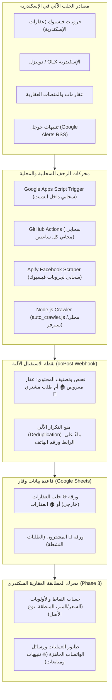

# دليل الأتمتة الكاملة: جلب العقارات والمشترين تلقائياً (بدون بوكماركليت نهائياً) 🚀

> **الهدف:** أتمتة كاملة 100% لخطي السير:
> 1. **جلب العقارات المعروضة للبيع (شقق، أراضي، محلات) في الإسكندرية.**
> 2. **جلب طلبات المشترين النشطين ("مطلوب شقة"، "مطلوب أرض"، "أبحث عن...") في الإسكندرية.**
> 3. **مطابقة ذكية فورية وتجهيز رسائل الواتساب وماسنجر بضغطة واحدة لأستاذة نورا إسماعيل.**
>
> ❌ **لا حاجة للضغط على Bookmarklet يدوياً في المتصفح!** كل شيء يعمل في الخلفية سحابياً أو ببرامج زحف مجدولة.

---

## 🏗️ كيف تعمل المنظومة المتكاملة؟



---

## ⚡ طرق التشغيل التلقائي المتاحة (اختر الأنسب لك)

| الطريقة | درجة السهولة | تشغيل بدون فتح الكمبيوتر؟ | التكلفة | الوصف |
| :--- | :---: | :---: | :---: | :--- |
| **1. تنبيهات جوجل RSS (سحابي أصيل)** | ⭐⭐⭐⭐⭐ (الأسهل) | ✅ نعم (سحابي 100%) | مجاني $0 | مدمج داخل Google Apps Script يعمل بتوقيت يومي تلقائي |
| **2. سحابة GitHub Actions** | ⭐⭐⭐⭐ | ✅ نعم (سحابي 100%) | مجاني $0 | يشغل `auto_crawler.js` كل ساعتين على سيرفرات جيت هب |
| **3. سحابة Apify لجروبات فيسبوك** | ⭐⭐⭐⭐ | ✅ نعم (سحابي 100%) | باقة مجانية كافية | يسحب المنشورات والتعليقات من جروبات فيسبوك ويبعثها فوراً للشيت |
| **4. تشغيل محلي بالكمبيوتر (Windows)** | ⭐⭐⭐ | ❌ يتطلب فتح الجهاز | مجاني $0 | تشغيل `run_crawler.bat` أو وضعها في جدولة مهام ويندوز |

---

## 1️⃣ تفعيل نقطة الاستقبال السحابية (Web App Webhook)

قبل تشغيل أي زاحف خارجي، تأكد من نشر كود البوت كنقطة استقبال (Web App):

1. افتح شيت وقار في جوجل > **Extensions** > **Apps Script**.
2. تأكد أن الملفات الثلاثة موجودة ومحفوظة:
   - `01_setup_database.gs`
   - `01_messenger_bot.gs`
   - `01_matching_engine.gs`
3. في الزاوية العلوية اليمنى، اضغط الزر الأزرق **Deploy** (نشر) > **New deployment** (نشر جديد).
4. اضغط أيقونة الترس بجانب "Select type" واختر **Web app** (تطبيق ويب).
5. اضبط الخيارات كالتالي:
   - **Description:** `Waqar Webhook v1`
   - **Execute as:** `Me (your_email@gmail.com)`
   - **Who has access:** `Anyone` (حتى يتمكن فيسبوك والزاحف من إرسال البيانات).
6. اضغط **Deploy** ووافق على الأذونات إذا طُلبت.
7. انسخ **Web app URL** (ينتهي بـ `/exec`).
   - هذا الرابط هو: `WAQAR_WEBHOOK_URL`.

---

## 2️⃣ الطريقة السحابية المجانية: GitHub Actions (كل ساعتين 100% أوتوماتيك)

هذه الطريقة الأفضل لأنها لا تتطلب ترك جهاز الكمبيوتر قيد التشغيل. سيرفرات GitHub ستشغل الزاحف كل ساعتين تلقائياً:

1. أنشئ مستودعاً خاصاً (Private Repository) على حسابك في GitHub باسم `waqar-crawler`.
2. ارفع إليه الملفين:
   - `auto_crawler.js`
   - المجلد `.github/workflows/waqar_crawler.yml`
3. في صفحة المستودع على GitHub:
   - اذهب إلى **Settings** > **Secrets and variables** > **Actions**.
   - اضغط **New repository secret**.
   - أضف السر:
     - **Name:** `WAQAR_WEBHOOK_URL`
     - **Value:** الصق رابط تطبيق الويب الذي نسخته أعلاه (`https://script.google.com/macros/s/.../exec`).
4. **مبروك!** سيعمل الزاحف كل ساعتين في الخلفية، ويجمع العقارات وطلبات المشترين، ويدرجها في الشيت ويشغل المطابقة تلقائياً!

---

## 3️⃣ الطريقة السحابية لسحب جروبات فيسبوك: Apify Cloud Scraper

جروبات فيسبوك العقارية في الإسكندرية (مثل *عقارات الإسكندرية*، *شقق للبيع بالإسكندرية*، *مطلوب شقة بالإسكندرية*) هي الكنز الحقيقي للمشترين والبائعين:

1. سجلي في موقع [Apify.com](https://apify.com) (حساب مجاني يقدم $5 رصيد شهري دائم يكفي لآلاف المنشورات).
2. ابحثي في الـ Store عن **Facebook Groups Scraper** (أو **Facebook Posts Scraper**).
3. ضعي روابط الجروبات السكندرية المستهدفة في إعدادات الـ Actor:
   - `https://www.facebook.com/groups/alexandria.realestate`
   - `https://www.facebook.com/groups/shooqalex`
   - أي جروب سكندري آخر.
4. اضبطي الكلمات المفتاحية: `للبيع`, `مطلوب`, `أرض`, `محل`, `شقة`.
5. في تبويب **Integrations / Webhooks** داخل الـ Actor في Apify:
   - اضغطي **Add Webhook**.
   - في خانة **Target URL**: ضعي رابط الـ Web App (`https://script.google.com/macros/s/.../exec`).
   - في خانة **Event**: اختاري `Run succeeded`.
   - Payload template: يرسل البيانات مع `action: "ingest"`.
6. بمجرد انتهاء تشغيل Apify، سيتم إرسال كل البائعين والمشترين فوراً إلى شيت وقار بدون أي تدخل يدوي!

---

## 4️⃣ الطريقة المحلية: تشغيل الزاحف من جهازك (Windows)

إذا كنتِ تريدين تشغيل الزاحف في أي وقت من جهازك:

1. افتحي الملف `run_crawler.bat` بواسطة المفكرة (Notepad).
2. استبدلي `PASTE_YOUR_WEB_APP_EXEC_URL_HERE` برابط الـ Web App الخاص بكِ.
3. احفظي الملف واضغطي عليه مرتين (Double Click).
4. ستظهر شاشة سوداء تجمع العروض والطلبات السكندرية وترسلها للشيت في ثوانٍ معدودة.

ولتشغيله في وضع المراقبة الدائمة في الخلفية:
```powershell
node auto_crawler.js --url "https://script.google.com/macros/s/.../exec" --watch --interval 60
```

---

## 5️⃣ ماذا يحدث بعد الجلب الآلي؟ (تجربة أستاذة نورا اليومية)

1. **في ورقة 🌐 جلب العقارات (خارجي):**
   - تظهر العقارات الجديدة مع رقم هاتف البائع أو رابط الإعلان وزر أخضر جاهز: **💬 تواصل واتساب سريع** يفتح رسالة تقديمية احترافية بنقرة واحدة.
2. **في ورقة 👥 المشترون:**
   - تظهر طلبات المشترين المجلوبة (الاسم، الهاتف/البروفايل، نوع الوحدة المطلوبة، الميزانية، والمنطقة).
3. **في ورقة 🔗 التطابقات و 🔥 تنبيهات ومتابعات:**
   - يطابق المحرك تلقائياً كل مشتري جديد مع أفضل 3 خيارات متاحة (مطابقة تامة + بديل موقع مجاور + بديل سعر قابل للتفاوض).
   - يتم تجهيز رسالة العرض المالي بدون إظهار رقم البائع أو العنوان التفصيلي لحماية عمولة وقار.
   - ضغطة واحدة على رابط الواتساب ترسل العرض فوراً للمشتري!
